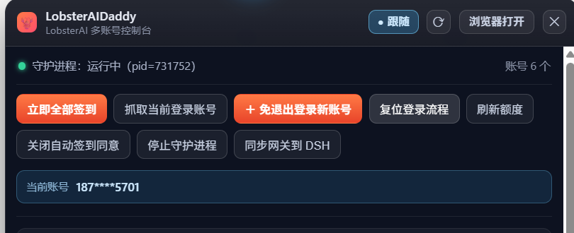
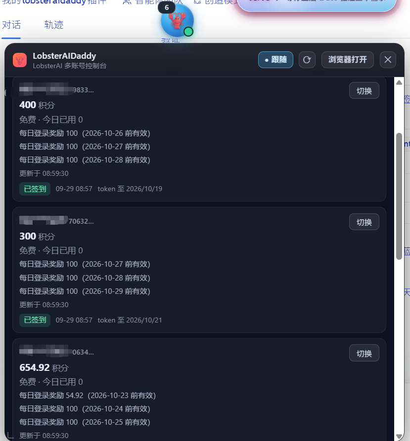

# dsh-lobsterai-daddy · LobsterAIDaddy

把 [LobsterDaddy](https://github.com/loyalchiiina) 多账号控制台变成 **DSH 界面上的悬浮球**：可自由拖拽摆放、位置自动记忆；面板可跟随悬浮球一起移动；点开即以内嵌的原生控制台直接操作账号、签到与切号。

A draggable floating ball that renders the LobsterDaddy multi-account console **as native DOM inside DSH**. Drag it anywhere, let the panel follow it, and manage accounts, check-ins and switching without leaving the harness.

---

## 效果图

### 多账号登录控制台



### 龙虾签到账号



---

## 功能

| 能力 | 说明 |
|---|---|
| 🟠 **悬浮球** | 常驻 DSH 界面，可拖到任意位置，坐标自动持久化（重启后原地出现） |
| 🧲 **面板跟随悬浮球** | 拖动悬浮球时面板一起走（相对位置不变）；面板头部也可单独拖动；「跟随 / 固定」一键切换并记忆 |
| 📥 **原生渲染控制台** | 点球展开/收起。抽屉内容自上而下：**操作按钮 → 当前登录账号 → 账号列表 → 运行信息** |
| 👤 **当前登录账号** | 自动读取 LobsterAI 的登录状态并显示昵称；**切号后自动更新**，无需手动抓取 |
| ✅ **签到状态与时间** | 每个账号显示 `已签到 / 今日已签到 / 今日未签到`，并附**最近签到时间**（`MM-DD HH:MM`） |
| 💰 **积分额度** | 余额、套餐、今日已用、奖励明细（含到期日） |
| 🦞 **免退出并行登录** | 「＋ 免退出登录新账号」扫码加入，账号数无上限 |
| 🔁 **一键操作** | 全部签到 / 复位登录流程 / 刷新额度 / 自动签到开关 / 守护进程开关 / 同步网关到 DSH / 切号 |
| ↔️ **自由调整大小** | 拖动抽屉左下角调整宽高，尺寸自动记忆 |
| 🔴 **实时状态点** | 球右下角圆点：绿=面板在线，灰=未启动 |
| 🔢 **账号数徽标** | 球左上角显示当前账号库数量 |
| 🌐 **浏览器打开兜底** | 头部按钮，由宿主进程**真正**拉起系统浏览器打开完整网页版 |

> ⚠️ **为什么不用 iframe 嵌网页（v0.3.0 起）**：DSH 桌面端页面运行在 `dsh-app://app` 协议下，该协议**只给顶层框架**发放 `x-dsh-desktop-renderer` 通行证，iframe 作为子框架永远拿不到 → 403 → 空文档；改用绝对 `http://127.0.0.1:port` 又被渲染进程 CSP 拦（实测 `Failed to fetch`）；DSH 还在 `main.js` 里主动禁用了 `webview`。**三条路都封死**，所以控制台改为在抽屉里用**原生 DOM** 绘制，数据经宿主同源代理用 `fetch` 获取（该通道实测可用）。

## 安装

```bash
# 从 npm
dsh plugin --profile desktop add dsh-lobsterai-daddy

# 或从 GitHub
dsh plugin --profile desktop add github:loyalchiiina/dsh-lobsterai-daddy
```

装完**重启 DSH** 生效（客户端 bundle 由宿主启动时加载）。

### 前置：LobsterDaddy 面板

悬浮球只是入口，真正的能力由 LobsterDaddy 提供。面板没起来时先跑：

```bash
node lobster-daddy.js panel --no-browser
```

（默认监听 `127.0.0.1:17819`，仅本机可访问；`--no-browser` 为后台常驻模式，不弹窗口、不开浏览器。）

## 原理

```
DSH 界面
  └─ 悬浮球（client.js，shadow DOM，position:fixed）
       └─ 抽屉 → 原生 DOM 渲染的控制台
            └─ fetch（根相对路径，走客户端 transport）
                 └─ /dsh-lobsterai-daddy/panel/api/*   ← 宿主端同源反向代理
                      └─ http://127.0.0.1:17819          ← LobsterDaddy 网页控制台
```

### 三条硬约束（改代码前必读）

1. **`fetch` 的 URL 必须保持根相对路径**。渲染进程的 CSP **拒绝绝对 loopback 请求**（实测 `relative-fetch status=200` 而 `loopback-fetch FAILED`）。曾把 URL 升级为 `http://127.0.0.1:<port>` 导致抽屉全空，客户端探针里有一条断言专门守这个。
2. **请求侧强制 `accept-encoding: identity`**。代理要往 HTML 里注入 shim 并重算长度，一旦面板返回压缩体而我们又重标了 `content-length`，浏览器会按 gzip 解压一段明文 → **白屏 / 乱码**。拿不到 identity 时**原样透传字节并保留原编码头**，绝不重新标注。
3. **非 `/status`、`/report`、`/current` 的路径全部转发给面板**。控制台自身用绝对路径 `fetch('/api/...')`，shim 会改写成 `/panel/api/...`；若代理只认 `/panel/*` 前缀而对其余路径回 404 JSON，控制台就会报 `刷新失败：Unexpected token 'o', "not found" is not valid JSON`。

### 路由

| 路由 | 用途 |
|---|---|
| `GET /dsh-lobsterai-daddy/status` | 宿主探活 + 面板健康（返回账号**数量**、面板端口） |
| `GET /dsh-lobsterai-daddy/current` | **当前登录账号**：只读 LobsterAI 的 SQLite（`kv` 表 `auth_tokens` / `auth_user`） |
| `GET /dsh-lobsterai-daddy/panel/*` | 面板同源反向代理（含 `/panel/api/*` 全部接口） |
| `GET /dsh-lobsterai-daddy/open` | 由宿主进程拉起系统浏览器打开完整网页版 |
| `POST /dsh-lobsterai-daddy/report` | 客户端诊断上报（写入 `~/.dsh/lobsterai-daddy-client.log`） |

> **为什么 `/current` 由宿主实现**：渲染进程打不开 SQLite。宿主只读打开 LobsterAI 的数据库并返回 `{available, uid, name, reason}`；任何失败都返回 `available:false` 而**不抛错**，绝不拖垮 `/status`。

## 配置

在 profile 的 patch 里可覆盖面板端口：

```yaml
- insert:
    - id: dsh-lobsterai-daddy
      name: dsh-lobsterai-daddy
      config:
        panelPort: 17819
```

## 兼容性

- DSH 桌面端 + 网页端均可用
- 与其它悬浮球插件（`dsh-todo-float-ball` 等）共存，各自独立定位与持久化
- 容器遵循 `position:static + pointer-events:none`，规避 Electron 下 `position:fixed` 子元素偏移问题
- 需要 Node.js ≥ 18；`/current` 依赖 `node:sqlite`（Node 22+ 内置），不可用时自动降级为不显示

## 安全说明

- 面板仅绑定 `127.0.0.1`；**所有插件路由同样只接受回环地址**，非本机请求返回 403
- `/current` 与 `/status` 会读取本机账号信息，因此同样受回环限制
- 不采集、不上传任何数据；账号凭据由 LobsterDaddy 存在本机 `%APPDATA%\LobsterDaddy\accounts`
- ⚠️ 多账号刷积分可能违反 LobsterAI 服务条款，**请只用于自己的账号**，风险自负

## License

MIT
